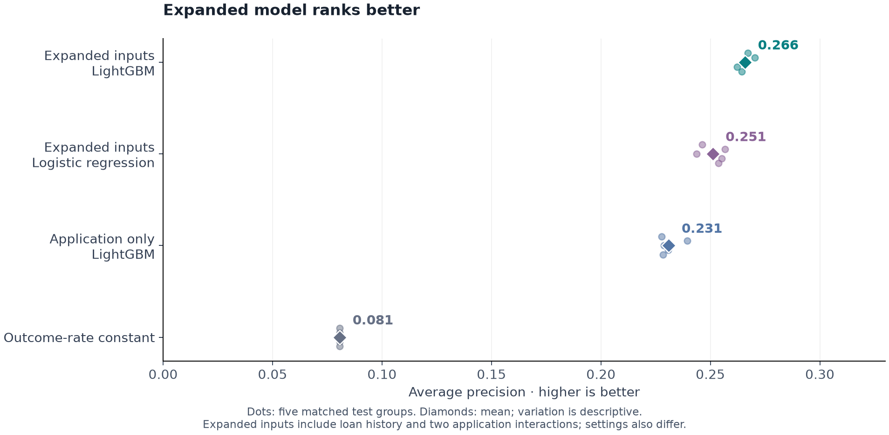

# Credit risk from application and repayment history

I built a SQL/DuckDB and Python pipeline to investigate whether application fields
and prior loan history can help rank applicants with recorded repayment difficulty.
The project joins public Home Credit tables, compares risk models and explains
the results in a browser report. It demonstrates data engineering, careful model
assessment and clear reporting in a local decision-support simulation.

**[Read the project report →](https://stevennitesh.github.io/loan-default-risk-decisioning-system/)**

The report contains the question, implementation, results and supporting methods.
No installation or data download is needed to read it.

## Main finding

The expanded LightGBM model captured **35.9% of recorded repayment-difficulty
cases in the highest-risk 10% of applicants**. Its mean average precision was
**0.266**, compared with **0.231** using application fields only, across
**261,384 labeled applicants** in five matched test groups. Average precision
measures how strongly difficulty cases concentrate near the top of a ranking;
it is not accuracy. Capture describes the highest-risk group, separate from the
simulated middle manual-review band.

Expanded inputs add loan history and two application-derived interactions;
each model's settings were selected separately. The comparison measures those
changes together. Prior exploration and random applicant groups limit
future-cohort claims. The public outcome is a repayment-difficulty proxy,
not measured financial loss; simulated decisions do not establish lending
readiness.

## What I built

- **Correct repayment accounting in SQL.** Multiple payments against one
  installment count as one obligation. Ambiguous schedules and unknown payments
  stay explicit, and dates constrain which history enters the model.
- **Matched model assessment in Python.** A constant benchmark, logistic regression
  and two LightGBM models predict the same applicant test groups. Model fitting,
  selection and probability-adjustment roles stay separate.
- **An explanation of probability quality.** A controlled follow-up changed only
  class weighting within fixed model recipes. Removing that weight largely
  explained why raw probability errors improved, while a broader tuning search
  produced little further ranking improvement.

## Inspect the implementation

**Stack:** SQL, DuckDB, Python, LightGBM, scikit-learn, SHAP and Matplotlib.

- [SQL feature assembly](sql/06_build_feature_mart.sql): one modeling row per applicant and source population.
- [Model assessment](src/nested_assessment.py): applicant roles, model selection and matched comparisons.
- [Repayment tests](tests/test_repayment_methodology.py): synthetic checks for split payments, date boundaries and ambiguous records.

The [run and reproduction guide](docs/RUNNING.md) covers code checks, report
generation, new pipeline runs and the inputs needed for exact historical
reproduction. The [assessment methodology](docs/validation/ASSESSMENT_METHODOLOGY.md)
explains the evaluation design; the [reports guide](reports/README.md) distinguishes
current evidence from historical experiments and Power BI demonstrations.

**Data source:** [Home Credit Default Risk on Kaggle](https://www.kaggle.com/competitions/home-credit-default-risk/overview).
Downloaded data, applicant-level outputs and fitted models stay local. Anonymous
aggregate results and final charts are committed so the report can be regenerated
without applicant data.
