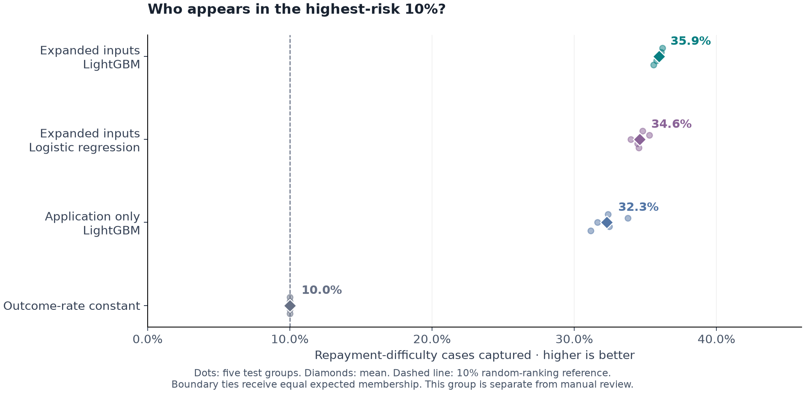

# Credit risk from application and repayment history

Text version of the [HTML project report](https://stevennitesh.github.io/loan-default-risk-decisioning-system/), the main reading destination for this project. The [standalone HTML](index.html) is the same report for offline use.

I built a SQL/DuckDB and Python pipeline that joins public loan and repayment tables, compares risk models, and produces an offline report.

Expanded inputs reached 0.266 average precision, compared with 0.231 using application fields only.

Expanded inputs add loan history and two application-derived interactions; model settings were selected separately. Results are five-group means. Average precision measures ranking, not accuracy. Earlier exploration and random applicant groups limit claims about future cohorts.

## The question

Loan applications contain current financial information, while separate tables record previous loans, monthly balances and repayments. This public Home Credit project asks whether joining that history improves ranking of applicants with observed repayment difficulty. The recorded target is a proxy for repayment difficulty, not measured financial loss.

**Data source:** [Home Credit Default Risk](https://www.kaggle.com/competitions/home-credit-default-risk/overview). The [official data description and downloads](https://www.kaggle.com/competitions/home-credit-default-risk/data) include `HomeCredit_columns_description.csv`, the source data dictionary. The assessment uses 261,384 labeled applicants; 46,127 other labeled applicants remain a separate historical comparison. Kaggle downloads require an account and acceptance of the competition rules.

## What I built

I joined loan and repayment records into one modeling record per applicant, using SQL and DuckDB for features and Python for model selection, scoring, interpretation and exports. Labeled assessment and unlabeled batch scoring stay separate.

The difficult part was counting financial events correctly. Split payments count as one installment obligation; ambiguous schedules and unknown payments remain explicit. Monthly delinquency rates use distinct applicant months, while account-month record counts keep their separate meaning. Bureau loans must originate before the application day. Identifiers, the outcome and direct demographic/protected-status-like fields are excluded from model inputs. Relative dates cannot certify when a lender could have obtained each field.

Public tables → SQL/DuckDB features → Python models → Reporting and batch scoring.

**Counting one obligation once — synthetic example.** A synthetic test records payments of 40 and 60 against one 100-unit obligation. The SQL result contains 100 units due and 100 paid, rather than counting the repeated amount due twice. The same test excludes a payment recorded after the application day. These are fixture values, not applicant records or dollars.

[Inspect the repayment fixture](https://github.com/stevennitesh/loan-default-risk-decisioning-system/blob/main/tests/test_repayment_methodology.py).

## Expanded inputs improve ranking in this assessment

The expanded LightGBM model reaches average precision 0.266, compared with 0.231 using application fields only. Average precision measures how strongly repayment-difficulty cases concentrate near the top of the ranking; it is not accuracy.

Expanded inputs mean application fields, loan history and two application-derived interactions. Each model's settings were selected separately, so the comparison measures these changes together rather than isolating loan history alone.

The expanded model captures 35.9% of observed repayment-difficulty cases in the highest-risk 10% of applicants, against a rounded 10% random-ranking reference. This group is separate from the middle manual-review band. Equal scores at the boundary receive equal expected membership; the methods retain the exact group-size and tie rules.

| Model / input scope | Average precision ↑ | ROC AUC ↑ | Brier score ↓ | Log loss ↓ |
|---|---:|---:|---:|---:|
| Training outcome rate · constant benchmark | 0.081 | 0.500 | 0.074 | 0.281 |
| Application fields only · LightGBM | 0.231 | 0.748 | 0.068 | 0.249 |
| Expanded inputs · logistic regression | 0.251 | 0.767 | 0.067 | 0.244 |
| Expanded inputs · LightGBM | 0.266 | 0.776 | 0.067 | 0.241 |

## Check probabilities separately

A model can rank applicants well and still overstate their risk. The expanded model's Brier score is 0.067 and log loss is 0.241; lower means smaller probability errors for both. All five history models selected the full 174 eligible inputs and raw probabilities; no probability-adjustment transform was selected.

Predicted probabilities track observed rates closely in this assessment. Across the 50 displayed score groups, the largest absolute difference is 1.07 percentage points. The predicted-versus-observed panel compares those rates; the gap panel exposes their difference in percentage points. The 50 displayed bins contain 5,227 to 5,228 applicants each; score ties stay together. This checks groups of similar scores, not every individual probability, and does not guarantee reliability in a new lending population.

## A broader search did not materially improve ranking

More tuning did not produce a meaningful ranking gain: average precision moved from 0.265750 to 0.265862. Raw probability errors improved substantially, while final probability quality stayed similar.

Several settings and search budgets changed together. The search comparison alone cannot attribute the improvement to one parameter; the controlled comparison below tests class weighting. A 20,000-applicant shuffled-outcome diagnostic returned roughly chance ranking, but cannot establish real-world field availability or erase earlier exploration.

## Test why the raw probabilities improved

Class weighting gives repayment-difficulty cases more influence during fitting. Here, the earlier weight made their influence roughly 9–11 times larger. The controlled comparison changes only that weight within each fixed model configuration and applicant group.

Removing class weighting is the dominant explanation for the better raw probabilities in these fixed configurations. Probability errors improved in all ten configuration/group pairs, and putting the earlier weight into the current configuration reversed the benefit. Using the earlier settings, mean predicted risk fell from 34.2% to 7.94%, against an observed difficulty rate of 8.07%. Raw Brier score fell from 0.1573 to 0.0666; log loss improved too. Average-rate agreement alone does not prove calibration.

Earlier probability adjustment had already repaired much of the scale error, so final probability quality changed little. This retrospective check holds other settings and one model seed fixed; it does not establish optimal weights for future cohorts or isolate the search screen's separate selection effect.

[Controlled comparison methods and exact results](https://github.com/stevennitesh/loan-default-risk-decisioning-system/blob/main/reports/class_weighting_20261004/assessment_report.md).

## What this demonstrates—and what remains unknown

This project demonstrates SQL data engineering, model comparison, probability diagnosis and reproducible reporting. It does not establish underwriting, compliance, fair-lending or adverse-action readiness.

The public data lacks calendar application, field-availability and outcome-maturity timestamps. Random applicant groups therefore cannot validate performance in a future cohort. Earlier exploration remains part of the project's history; these results are not an untouched final test. Unlabeled Kaggle applications demonstrate batch scoring only and contribute no outcome metrics.

Committed anonymous aggregates regenerate this presentation. Downloaded data and current code can run a new pipeline; exact historical execution also requires retained original models, memberships and source archives that stay local. The saved Power BI files and screenshots are unrefreshed historical demonstrations.

## Supporting evidence and methods

The sections below retain the assessment details, segment checks, model-input explanations and simulated decision assumptions.

## Compare models on the same applicants

The assessment covers 261,384 labeled development applicants in five applicant test groups. Each group is predicted by models whose fitting and selection used the other groups. A constant outcome-rate benchmark, logistic regression, application-only LightGBM and history LightGBM predict the same test applicants. Logistic regression is the simpler linear benchmark; LightGBM combines decision trees. Means summarize five separate metrics, not one pooled cross-model score.

Prior public-data exploration remains: this is not an untouched final test or a future-cohort assessment.

[How fitting, selection and assessment are separated](https://github.com/stevennitesh/loan-default-risk-decisioning-system/blob/main/docs/validation/ASSESSMENT_METHODOLOGY.md).

## Check the installment-history boundary

The expanded LightGBM model has higher average precision within each declared installment-history group: known installment payments: 0.237 to 0.269; ambiguous or unknown payments: 0.199 to 0.262; no installment obligations: 0.212 to 0.219. Small connected dots show the same five test groups for both models; large diamonds show their mean scores. Applicant counts and recorded difficulty rates appear above each panel. Those rates differ, so compare models within each panel. These labels describe installment records and payment support; no installment obligations does not imply absence of bureau or other loan history. Results are descriptive, with no significance claim.

## Explain the expanded model's inputs

The five assessed expanded LightGBM models use 174 eligible raw inputs. Mean external credit score and Employment length lead individual input magnitudes; application finances and context have the largest cumulative group magnitude. Supplied credit scores are application inputs, so the signal should not be credited entirely to engineered history.

SHAP attributes a model's score to its inputs. Here, contributions use the model's internal log-odds scale rather than percentage changes in predicted risk. The chart sums absolute contributions, so a group's total depends on its input count and correlated fields. These magnitudes are not signed net effects, probability changes, causal effects or shares of predictive performance.

The diagnostic reuses the five existing fitted models on bounded samples selected without using outcomes. It performs no fitting or selection. Sampling, aggregation across encoded inputs and separate checks that signed contributions reproduce model scores are documented in the methods download; these are not adverse-action reasons.

[Sampling and contribution methods](model_input_methods.md).

| Input group | Raw inputs | What it describes |
|---|---:|---|
| Application finances and context | 24 | Requested credit, income, annuity, financial ratios, employment and application context. Direct demographic/protected-status-like fields are excluded; remaining context can still contain proxies. |
| Imported external credit scores | 7 | Three supplied external-score fields and their mean, minimum, maximum and missing-count summaries. Their original construction and real-time availability cannot be independently certified. |
| Bureau loans and balances | 35 | Counts, amounts, debt, overdue status and relative dates for bureau loans originating before application day; monthly balance status and recent deterioration. |
| Cash-loan monthly history | 28 | Monthly loan status, days past due, remaining installments and recent/last-loan deterioration. Delinquency rates and last-three-month windows use distinct applicant months; record counts retain account-month grain. |
| Credit-card monthly history | 42 | Balances, limits, utilization, drawings, payment support and delinquency, with recent and last-loan summaries. |
| Installment repayment history | 21 | Payment timing, shortfalls, arrears and recent repayment behavior. Obligations are counted once across split payments; ambiguity and unknown payment support remain explicit. |
| Previous loan applications | 13 | Prior Home Credit application outcomes, requested and granted amounts, approval/refusal rates and relative decision dates. |
| Combined financial pressure | 4 | Ratios combining external scores or application income/credit with bureau debt and installment payment shortfall. These groups overlap information sources. |

## Show decisions as assumptions, not lending advice

A lower score cutoff separates simulated approval from manual review; an upper cutoff separates manual review from simulated decline. Cutoffs come from model-selection applicants and are applied unchanged to assessment applicants. Only the middle band incurs review cost. Simulated declines issue no loan and contribute zero modeled margin, loss or review cost. The example weights are 1,000 units for an approved applicant without recorded difficulty, 5,000 units of loss for an approved applicant with difficulty and 50 units per review. Utility is in illustrative units, not dollars or profit. Sensitivity checks vary each weight by 0.5, 1 and 2. No reviewer effectiveness, rejected-loan counterfactual or hard review-queue limit is estimated.

## Check sensitivity without re-optimizing policies

The expanded LightGBM model has the highest mean simulated utility among the three assessed models in 27 of 27 cost combinations. The chart subtracts the application-only LightGBM model's mean utility from each expanded model's mean. The zero line represents application-only; positive differences favour the expanded model. Each point compares the same five test groups. These are additional illustrative utility units per applicant, not dollars or profit.

Each model keeps the score cutoffs and actions from its five fitted policies fixed (15 policies in total). Varying margin, loss and review-cost weights does not optimize a new policy. The three panels show margin multipliers of 0.5, 1 and 2; each contains all nine combinations of loss and review-cost multipliers. The constant ranking benchmark is not part of this grid. Only the middle manual-review band incurs review cost; simulated declines contribute zero modeled utility. These descriptive results remain conditional on the illustrative formula and public-data population, with no significance claim.

## Metric glossary

| Measure | Meaning | Direction | Units |
|---|---|---|---|
| Average precision | Start with the highest-risk applicants, then include progressively more. Average precision summarizes the share of each group with recorded repayment difficulty, weighted by the additional difficulty cases captured. It measures ranking, not accuracy. | Higher is better | Unitless, 0 to 1 |
| ROC AUC | How often a repayment-difficulty case receives a higher score than a case without difficulty, with half credit for ties. | Higher is better | Unitless, 0 to 1 |
| Brier score | Mean squared difference between predicted probability and the recorded binary outcome. | Lower is better | Squared probability error |
| Log loss | Probability error that penalizes confident incorrect predictions more strongly; uses natural logarithms. | Lower is better | Unitless |
| Repayment-difficulty cases captured in highest-risk group | Share of recorded repayment-difficulty cases captured among the highest-risk fraction of applicants (10% in this assessment), using equal expected membership for boundary ties. Separate from middle-band manual review. | Higher is better at the same group size | Fraction; displayed as a percentage |
| Illustrative utility per applicant | Assumed approved-loan margins minus assumed losses and middle-band review costs, divided by applicant count. Not dollars or measured profit. | Higher only under the same assumptions | Illustrative utility units per applicant |

## Explore the evidence

- Read online: [browser report](https://stevennitesh.github.io/loan-default-risk-decisioning-system/) or [standalone offline report](index.html).
- Check the exact results: [numeric appendix](metrics.csv), [metric dictionary](metric_dictionary.csv) and [presentation provenance](provenance.json).
- Understand the model inputs: [frozen-model methods](model_input_methods.md), [input dictionary](model_input_dictionary.csv) and [input magnitudes](model_input_summary.csv).
- Read the technical assessment: [current procedure](https://github.com/stevennitesh/loan-default-risk-decisioning-system/blob/main/reports/tuning_20261004/assessment_report.md) and [controlled weighting follow-up](https://github.com/stevennitesh/loan-default-risk-decisioning-system/blob/main/reports/class_weighting_20261004/assessment_report.md).
- Follow the development trail: [historical experiment archive](https://github.com/stevennitesh/loan-default-risk-decisioning-system/blob/main/reports/experiments/README.md).

Install the dependencies using [the run guide](https://github.com/stevennitesh/loan-default-risk-decisioning-system/blob/main/docs/RUNNING.md#check-the-code-without-data), then regenerate with `make portfolio` (Windows: `make portfolio PYTHON=python`). Only committed anonymous aggregates are read; no raw data, saved model or new fitting is required.
